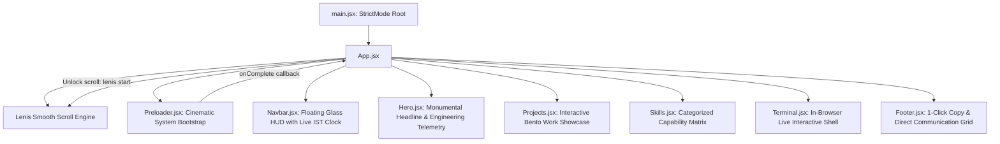

# Technical Architecture & Engineering Specifications

This document outlines the architectural patterns, state lifecycles, and physics-based interaction models implemented within the **Animated Portfolio** application.

---

## 1. System Architecture Overview

---

## 2. Component Design & Capabilities

### 2.1 The Floating HUD Capsule (`src/components/Navbar.jsx`)
- Fixed floating glassmorphism capsule with active directional scroll awareness.
- **Live IST Clock**: An active `Intl.DateTimeFormat` timer running on an isolated tick interval with zero parent re-renders.
- **Availability Beacon**: Live pulse indicator displaying project availability.
- **Anchor Jumping**: Native element scrolling intercepted by Lenis for uniform smooth scrolling.

### 2.2 Monumental Architectural Hero (`src/components/Hero.jsx`)
- Eliminates generic AI tropes (centered 3-line headline with glowing green radial blobs).
- Features full-width typography (`clamp(3.5rem, 11vw, 10rem)`) commanding screen space.
- Real engineering telemetry:
  - Precise geographical coordinates (`22.30° N, 73.18° E`)
  - Direct email 1-click clipboard copy with visual feedback toast
  - Subtitle focused on real-world engineering (distributed systems, RAG, concurrency).

### 2.3 Interactive Bento Work Showcase (`src/components/Projects.jsx`)
- **Card 1: AI Document Analyzer (8 Columns)**
  - Embedded real video demo player with HUD status tag.
  - Architecture breakdown: Semantic chunking with sliding windows, Pinecone cosine similarity, and Gemini multimodal synthesis.
  - Query latency benchmark: `<120ms Vector Retrieval`.
- **Card 2: Seat Reservation Engine (4 Columns)**
  - **Live Concurrency Simulator**: Visitors click seats to trigger simulated atomic WebSocket locking, handling concurrent conflict rejection in real time.
- **Card 3: AMS Hardware Configurator (12 Columns)**
  - **Interactive Dependency Graph Calculator**: Dynamically calculates system power draw (TDP) across selected GPUs and validates socket constraints.

### 2.4 Engineering Capability Matrix (`src/components/Skills.jsx`)
- Replaces the meaningless spinning text marquee with a categorized, tabbed technical matrix:
  - `01. Core Architecture & Frontend` (React 19, TypeScript, Tailwind v4, GSAP)
  - `02. Backend Systems & Real-Time` (Python, FastAPI, Node.js, WebSockets)
  - `03. Applied AI & Data Infrastructure` (Gemini SDK, Pinecone, MongoDB)
  - `04. Engineering Practices & Tooling` (Vite 8, Git, Linux, ESLint 10)
- Each item displays proficiency tier and real-world implementation notes.

### 2.5 In-Browser Interactive Terminal (`src/components/Terminal.jsx`)
- A real interactive shell widget equipped with developer commands (`whoami`, `skills`, `projects`, `status`, `contact`, `clear`).
- Supports both keyboard typing and 1-click quick-action pills for mobile/touch usability.

### 2.6 High-Impact Footer (`src/components/Footer.jsx`)
- Monumental call to action with 1-click email copy.
- Direct repository links (GitHub, LinkedIn, Resume PDF).
- Smooth scroll-to-top trigger.

---

## 3. Styling & Cursor Engine (`src/index.css`)

- Native CSS SVG data-URI cursors for zero-lag pointer tracking.
- Tailwind CSS v4 `@theme` tokens for typography (`Space Grotesk`, `JetBrains Mono`, `Syne`).
- Subtle engineering grid patterns (`.bg-grid-pattern`) and glassmorphic panels (`.glass-panel`).
